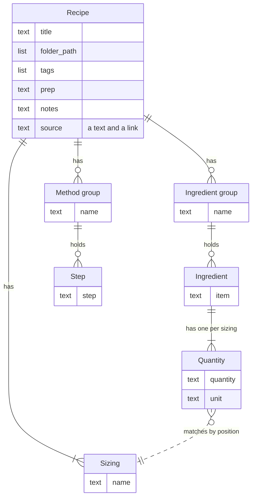
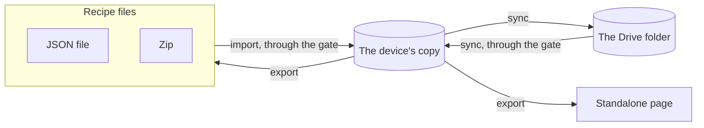

# Data model

Rosa's data is the cookbook: a set of recipes, each one a single document. A device holds one copy of the cookbook, Drive can hold another, and recipes leave and enter a device as files.

This page covers the shape of a recipe and the rules it follows, where copies of the cookbook live, the values a device holds in localStorage, the gate, and renaming and removing folders. The services that storage and sync run on are on [External dependencies](dependencies.md).

## The Recipe's shape

The Recipe is a single document, not seven tables. Everything in the diagram is nested inside it.

## Design rules

- **The id never follows the title.** A recipe's id is made once, from its first title. Renaming the recipe leaves the id, and so the recipe's URL, as they were.
- **Folders exist only as paths on recipes.** Nothing stores a folder by itself. The tree of folders is worked out from the folder paths of the recipes.
- **Quantities match sizings by position.** An ingredient's first quantity belongs to the recipe's first sizing, its second to the second, and so on. A quantity carries no reference to its sizing.
- **A recipe is stored once it has a title.** Until then a new recipe exists only in the editor session.
- **An edit beats a delete.** When one device deleted a recipe and another changed it, with no sync in between, the recipe stays, with the change.
- **Crossed edits favour the device that syncs.** Crossed edits are settled part by part against the last-agreed state. A part that only one device changed is taken from that device. A part that both changed is taken from the device that is syncing. The eight parts are listed under "Part" in the [glossary](../GLOSSARY.md).
- **Deletion leaves a marker.** A deleted recipe leaves a deletion marker behind, so that the deletion can reach other devices through sync and a later import can restore the recipe.

## Where copies live

- **On the device**: in the browser's IndexedDB. This is the copy Rosa reads and writes, whether or not the device syncs.
- **In the Drive folder**: one JSON file per recipe. Beside them sit a few control files that belong to the replication plugin.
- **In export files**: a JSON file holding one recipe, a zip of such files when there are several recipes, or a standalone page.

## Values in localStorage

Apart from its copy of the cookbook, a device holds ten small values in the browser's localStorage.

| Key                  | Holds                                                                            |
| -------------------- | -------------------------------------------------------------------------------- |
| `rosa.sides`         | The part of the open set that outlasts a reload.                                 |
| `rosa.appearance`    | The appearance the cook chose.                                                   |
| `rosa.divider`       | Where the divider between two sides sits.                                        |
| `rosa.sidebar-width` | How wide the Contents is.                                                        |
| `rosa.keep-refused`  | When the browser last declined to guard the device's copy against being cleared. |
| `rosa.drive-token`   | The auth token and when it expires.                                              |
| `rosa.drive-address` | The email address of the Google account the device syncs with.                   |
| `rosa.drive-used`    | That this device syncs.                                                          |
| `rosa.drive-fetched` | That the first fetch has finished.                                               |
| `rosa.drive-folder`  | Which Drive folder this device syncs with.                                       |

## The gate

A recipe from outside the device passes the gate before it enters the cookbook. With an imported file the gate is strict and can refuse the recipe. With a recipe arriving from Drive it is lenient: it makes what it can of the recipe and always accepts it.

## Folder rename and remove

Renaming or removing a folder rewrites the folder path of every recipe under it. Removing a folder moves what it held up one level and deletes nothing.
