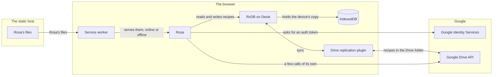

# External dependencies

Rosa leans on seven things it does not own. Most of them run in the browser beside it. Only two are reached over the network: the static host, which Rosa's files come from, and Google, which a device talks to only when the user syncs.

This page covers the seven dependencies and what Rosa uses each for. The diagram shows the ones that exist while Rosa runs. Angular with the CDK, and the client ID, appear only in the table.

| Dependency                             | What Rosa uses it for                                                                                                                                                                                                                                                                                         |
| -------------------------------------- | ------------------------------------------------------------------------------------------------------------------------------------------------------------------------------------------------------------------------------------------------------------------------------------------------------------- |
| RxDB on Dexie                          | Storage. RxDB is the database that holds the device's copy of the cookbook, and Dexie is the layer that puts it in the browser's IndexedDB.                                                                                                                                                                   |
| RxDB's Google Drive replication plugin | Sync. It carries changes between the device's copy and the Drive folder, in both directions. Rosa loads it the first time a device uses Drive, and runs it with a patch, described below.                                                                                                                     |
| Google Identity Services               | Sign-in. It asks the user to let Rosa reach their Drive and hands the device an auth token. Rosa asks for the `drive.file` scope only, which covers the files Rosa itself created. The token expires after about an hour, and the device holds it in the browser's localStorage so that it outlasts a reload. |
| Google Drive API                       | A few calls Rosa makes itself, apart from the plugin: finding the Drive folder, asking what became of a Drive folder that is no longer the one in use, deleting the Drive folder for Clear Drive, and reading the email address of the Google account.                                                        |
| Angular and the CDK                    | The framework the app is written in. The CDK supplies drag and drop.                                                                                                                                                                                                                                          |
| Service worker and static hosting      | A static host serves Rosa's files. The service worker holds them on the device, so that Rosa opens offline.                                                                                                                                                                                                   |
| Google client ID                       | A value a build needs for Drive to appear. A build without one shows no sync control and no Google Drive section in Settings, and works the same in every other way.                                                                                                                                          |

## The patch to the replication plugin

`patches/rxdb+17.6.0.patch` changes the plugin's code when Rosa's dependencies are installed. All of it concerns how the plugin handles the files in the Drive folder.

- **File versions are read from the response body.** The plugin took a file's version from a response header, and Drive does not let a browser read that header.
- **A control file is looked for before it is created.** One that is already there is used, and no second copy is added. Of several copies, the oldest is the file.
- **A folder is read in full.** The plugin read one page of a folder's listing. The patch follows every page, oldest file first.
- **A claim to write checks the version first.** A device reads the version of the file it is about to claim before it reads the content, so a competing claim that lands in between is refused.
- **Empty batches are not written.** A batch with no changes in it is skipped.
