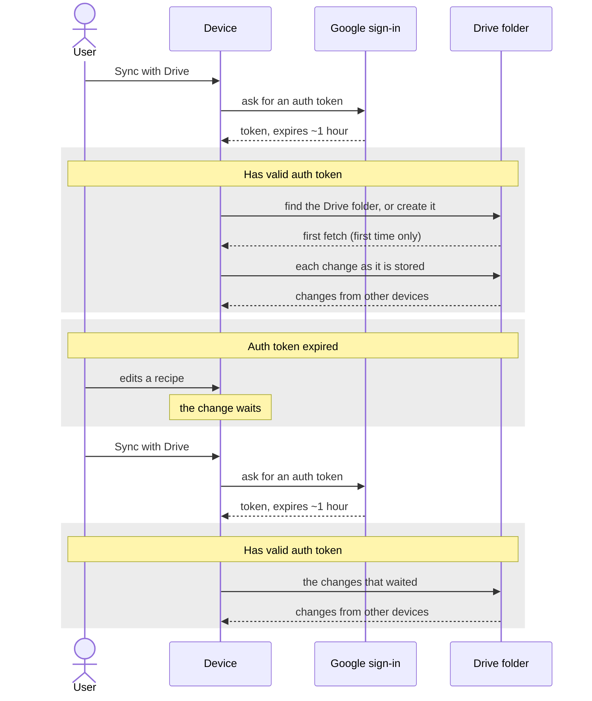
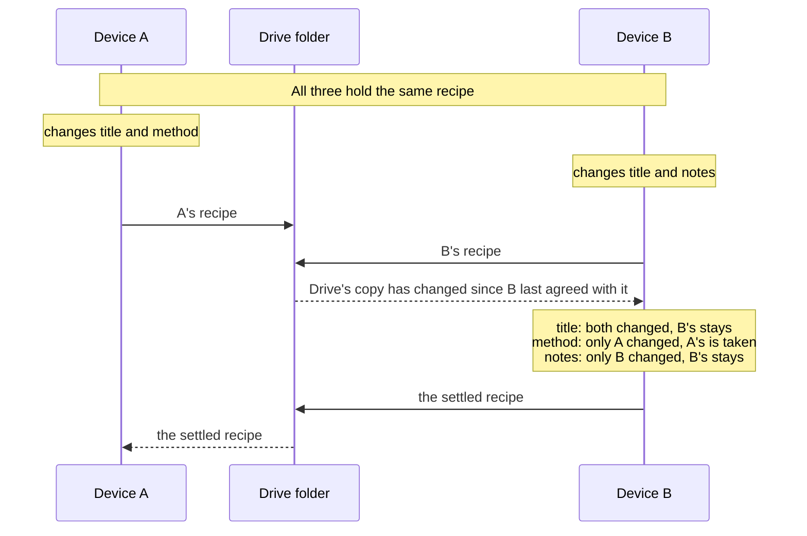
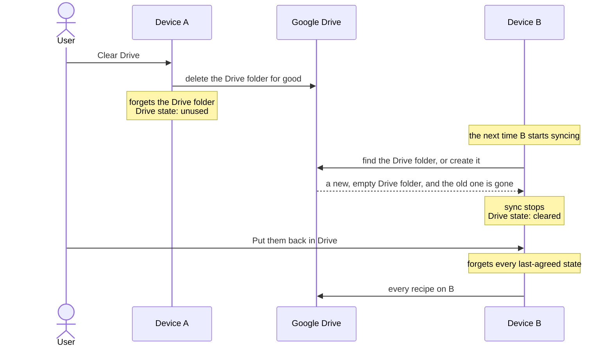

# Drive

A user can keep one more copy of the cookbook in their own Google Drive and sync each device with it. Sync is optional and set up per device. A device that never syncs works the same in every other way.

This page covers where a device stands with Drive at any moment, and the three flows that involve Drive. The services behind sync are on [External dependencies](dependencies.md), and what the Drive folder holds is on [Data model](data-model.md).

## Drive state

Drive state says where one device stands with Drive right now. It is a ladder: Rosa checks the cases below from the top and takes the first that holds. There are no transitions to follow. When a fact changes, the state is worked out again.

| #   | State           | Holds when                                                                       |
| --- | --------------- | -------------------------------------------------------------------------------- |
| 1   | `unused`        | The device has never synced, or the user disconnected it.                        |
| 2   | `cleared`       | The Drive folder this device synced with has been deleted.                       |
| 3   | `moved renamed` | That Drive folder has been moved or renamed, and Rosa has made a new, empty one. |
| 4   | `moved trashed` | That Drive folder is in Drive's bin, and Rosa has made a new, empty one.         |
| 5   | `broken`        | Drive failed in a way Rosa does not expect to pass.                              |
| 6   | `token expired` | The device's auth token has expired.                                             |
| 7   | `offline`       | The device has no network.                                                       |
| 8   | `fetching`      | The first fetch has not finished.                                                |
| 9   | `syncing`       | The user has just pressed "Sync with Drive" and the device is catching up.       |
| 10  | `pending`       | The device and Drive have been out of step for more than 30 seconds.             |
| 11  | `up to date`    | None of the above. The device and Drive agree.                                   |

In states 2 to 5 sync has stopped. Only `cleared` offers a way on, which is "Put them back in Drive".

The Google Drive section of Settings shows the state. The sync control beside the Settings button appears in `token expired`, where it offers "Sync with Drive", and when the user has asked for a sync, to show it running and how it ended.

### The auth token

Syncing needs a Google auth token. A token expires after about an hour, and Rosa never gets a new one by itself: it asks Google when the user presses "Sync with Drive". So a device that syncs alternates between two conditions:

- **Valid auth token**: the device syncs without being asked. States 7 to 11 occur only here.
- **Auth token expired**: changes are stored on the device as usual and wait there, and the sync control marks that some are unsent. Syncing starts again when the user presses "Sync with Drive".

## Syncing with Drive

- **First fetch** happens once per device. Until it finishes, the device may not hold every recipe.
- **Arriving recipes** pass the gate, which is lenient with Drive. See [Data model](data-model.md).
- **Resuming**: the device holds the token in the browser, so while it is valid sync picks up by itself after a reload, when the network returns, and when the user comes back to the browser tab.
- **Disconnect** returns the device to `unused`. The device's copy and Drive's copy both stay as they are.

## Crossed edits between two devices

Two devices change the same recipe with no sync in between. The second device to sync settles the recipe part by part, measuring both versions against the last-agreed state.

A's title is lost, because both devices changed that part and B was the one syncing. The rules, including what happens when one device deleted the recipe, are on [Data model](data-model.md).

## Clearing Drive and putting recipes back

Clear Drive removes Drive's copy of the cookbook and nothing else. Every device keeps its own copy, and any of them can put the recipes back.

- **With an expired token**, Clear Drive and "Put them back in Drive" get a new one from Google first, as "Sync with Drive" does.
- **Put back overrides.** With no last-agreed state, B's version of every recipe replaces whatever another device has already put in the new Drive folder.
