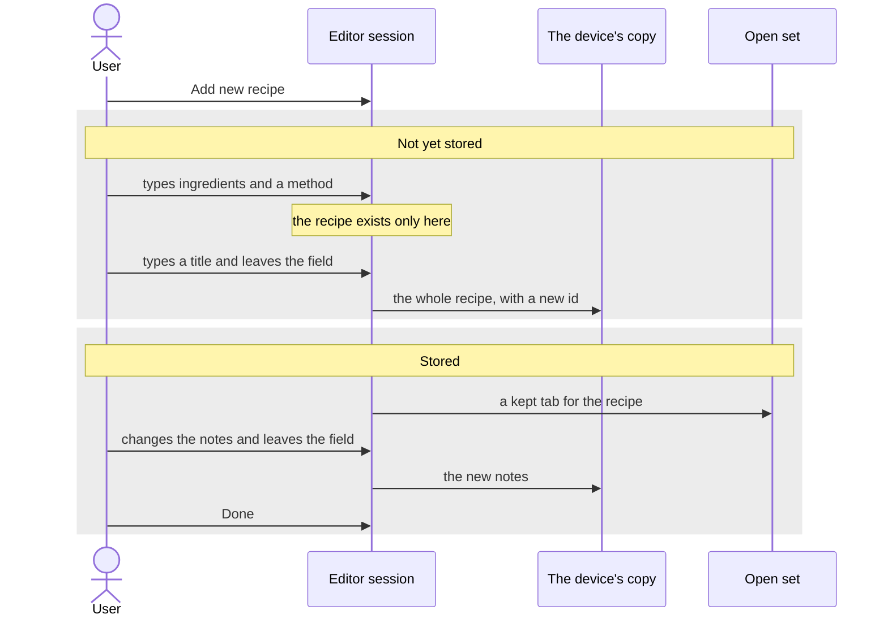
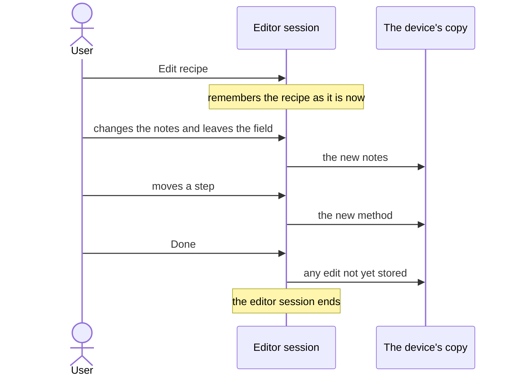

# Editing

A user writes and changes recipes in the editor. The editor has no button for storing a recipe: edits are stored as you go, and "Done" only closes the editor.

This page covers the editor session and the two flows that pass through it. The shape of a recipe and the rules it follows are on [Data model](data-model.md), and tabs are on [Open set](open-set.md).

## The editor session

The editor session is what the editor holds while it is open: the recipe as the user has changed it so far and, when the recipe was already stored, the recipe as it was when the editor opened. It starts when the user presses "Edit recipe" on a recipe or "Add new recipe", and it ends when the editor closes. A device has one at most. What the user types changes the editor session first, and the cookbook only once the edit is stored.

## Writing a new recipe

A new recipe starts empty and exists only in the editor session. It is stored once it has a title.

- **The title decides.** The recipe is stored when the user leaves the title field with a title in it, whatever else has been filled in. Closing the editor counts as leaving the field.
- **The id** is made at that moment, from the title. See [Data model](data-model.md).
- **The tab**: once stored, the recipe opens in a kept tab in the focused side.
- **Leaving without a title** stores nothing. If the recipe has anything in it, Rosa asks first, offering "Back to it" and "Discard it".

## Editing and storing

Editing a stored recipe changes the cookbook as the user goes. The example below changes the notes and then the method.

- **When an edit is stored**: typed text is stored when the user leaves the field. Every other edit, such as moving a step, adding a sizing, choosing a folder or changing the tags, is stored as it is made.
- **The title cannot be emptied.** Leaving the title field empty puts the stored title back.
- **"Revert"** stores the recipe again as the editor session remembers it, and the editor stays open. Rosa asks first. It is offered only when the editor opened on a stored recipe.
- **"Delete"** ends the editor session, closes the recipe's tab and deletes the recipe, which leaves a deletion marker. Rosa asks first. See [Data model](data-model.md).
