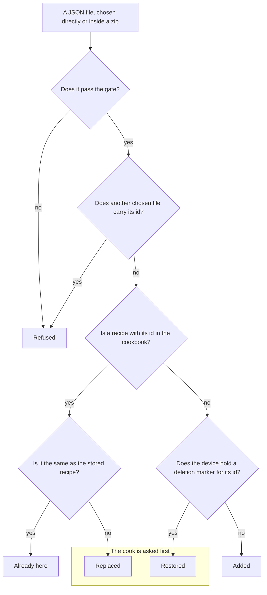

# Export and import

Recipes leave a device as files and come back as files. Export makes one file from the recipes the cook picks. Import reads files the cook chooses and puts their recipes in the cookbook. Both are in Settings.

This page covers the two flows. The export files, and the gate an imported recipe passes, are on [Data model](data-model.md).

## Export

Export is a straight line of three steps.

1. The cook picks recipes, by ticking recipes or whole folders.
2. The cook picks a format: "JSON" for files that import can read, or "HTML" for a standalone page.
3. Rosa builds one file on the device and hands it to the browser to download.

Each recipe on a standalone page is rendered by the same component that shows a recipe in a side.

## Import

The cook presses "Choose files" and picks any number of JSON files and zips. Rosa reads every JSON file among them, whether chosen directly or inside a zip, and sorts each recipe into one of five outcomes before it writes anything. A file holds one recipe. Inside a zip, files that are not JSON are passed over.

- **Refused**: nothing from a refused file is written. A file is refused when the gate finds a fault in it, the gate being strict with imported files (see [Data model](data-model.md)). It is also refused when another chosen file carries the same id, in which case every file with that id is refused. A zip that cannot be opened is refused whole, and so is a file inside a zip that cannot be unpacked.
- **Already here**: the comparison is made after the gate has tidied the file, and it ignores sizing ids.
- **Added**: a file with no id is given a new one by the gate, so it is always added, and importing it twice adds two recipes.
- **Restored**: the recipe comes back from the file, under the id it had. The deletion marker is what makes Rosa ask. Without it the recipe would simply be added.
- **Asking**: if any recipe would be replaced or restored, Rosa lists those recipes and asks, with replacing ticked and restoring not. The cook can change either tick, or cancel, which writes nothing at all. If none would, Rosa writes the added recipes without asking.
- **The report**: afterwards Rosa says how many recipes were added, replaced, restored and already here, how many it left as they were because the cook did not tick them, how many it could not write, and why each refused file was refused.
