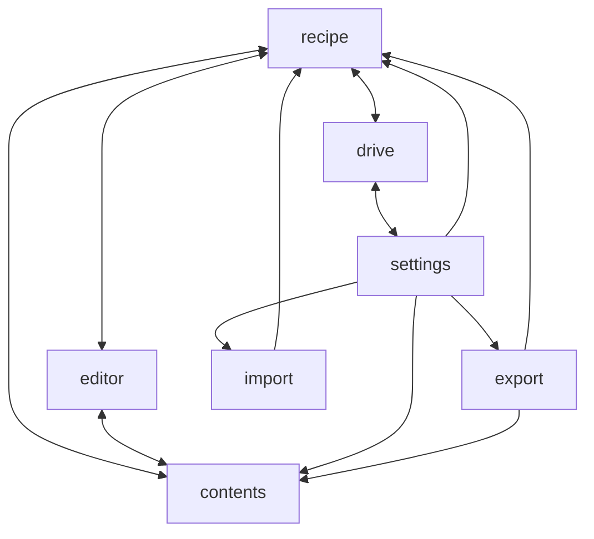

# Module map

Rosa's code is divided into nine areas. Eight are folders under `src/app`. The ninth, root, is the few files that sit directly in `src/app`.

This page covers what each area is responsible for and which areas depend on which.

## The nine areas

| Area       | Responsible for                                                                                                                                                                 |
| ---------- | ------------------------------------------------------------------------------------------------------------------------------------------------------------------------------- |
| `recipe`   | The Recipe and the gate, the device's copy of the cookbook, folders, settling crossed edits, the open set and the URL, and showing a recipe, the tabs and the resting state.    |
| `editor`   | The editor and the editor session behind it: ingredients and method in groups, sizings, the folder picker, tags, and dragging to rearrange.                                     |
| `contents` | The Contents, where the user finds recipes: the folder tree, search, and renaming and removing folders.                                                                         |
| `drive`    | Sync: signing in and the auth token, the Drive folder, Drive state, Clear Drive and Put back, and the sync control.                                                             |
| `export`   | Building the JSON file, the zip and the standalone page, and handing the file to the browser to download.                                                                       |
| `import`   | Reading JSON files and zips, passing each recipe through the gate, and working out and writing what an import adds, replaces and restores.                                      |
| `settings` | The Settings sheet and its sections: Google Drive, import and export, and appearance.                                                                                           |
| `shell`    | Building blocks the other areas share, which know nothing about recipes: sheets, confirm dialogs, resize grips, the divider, and the helper that reads and writes localStorage. |
| root       | The frame of the app. It lays out the Contents, the sides and the sheets, and handles the keyboard shortcuts for tabs.                                                          |

## Dependencies between areas

An arrow runs from an area to an area whose code it imports. A double-headed arrow means each imports from the other.

Two areas are left off the picture:

- **`shell`**: every area except `import` uses `shell`, and `shell` uses none of them.
- **Root**: root wires up the areas, and `export` borrows root's frame styles for the standalone page.
