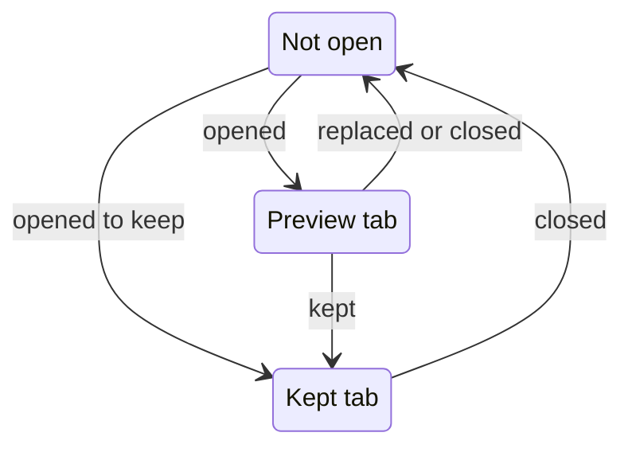
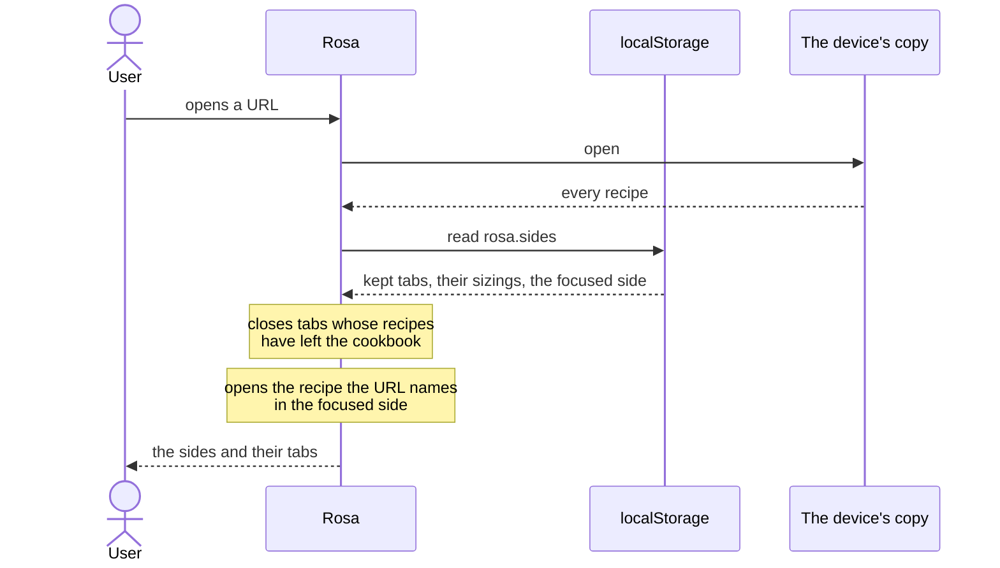

# Open set

The open set is what a device knows about the recipes it has open: one or two sides, the tabs in each, which side is focused, and which sizing each open recipe shows. It belongs to the device, not to the cookbook.

This page covers the open set, what a side shows when it has no recipe to show, and what happens when the app opens. The `rosa.sides` value named below is listed with the other localStorage values on [Data model](data-model.md).

## The open set

A side holds any number of kept tabs and at most one preview tab. A recipe is open in at most one side, so opening a recipe that is already open shows the tab it has. A recipe's tab is in one of three states.

- **Opening**: a click on a recipe in the Contents opens it in a preview tab. A double click, a click with Ctrl or Cmd held, or a middle click opens it in a kept tab.
- **Keeping**: double-clicking a preview tab, or dragging it, makes it a kept tab. A kept tab never goes back to being a preview tab.
- **Replacing**: a side's preview tab gives way to the next recipe that opens in a preview tab in that side.
- **Closing**: a tab closes when the user closes it, and when its recipe leaves the cookbook.

The open set starts with one side and never has more than two. The user makes the second by dragging a tab to the left or right of the first, which a side allows once it holds more than one tab. With two sides, dragging a tab onto the other side moves it there, and a side whose last tab is closed or moved away goes too.

One side is the focused side. Pressing in a side, or on its tabs, focuses it. A recipe opened from the Contents opens in the focused side. If it is already open in the other side, that side shows it and becomes the focused side.

The open set also holds which sizing each open recipe shows. Until the user chooses one, a recipe shows its first sizing.

Two things outlast a reload: the `rosa.sides` value in localStorage, and the URL. The URL is `/recipe/` followed by the id of the recipe the focused side shows, or `/` when that side shows no recipe.

| Part of the open set                                        | After a reload                                                                                     |
| ----------------------------------------------------------- | -------------------------------------------------------------------------------------------------- |
| Kept tabs, in their sides and in order                      | Come back, from localStorage.                                                                      |
| The sizing each kept tab shows                              | Comes back, from localStorage.                                                                     |
| Which side is focused                                       | Comes back, from localStorage.                                                                     |
| The recipe the focused side shows                           | Comes back, from the URL. It opens in its kept tab if it has one, and in a preview tab if not.     |
| The recipe the other side shows                             | Comes back, from localStorage, if it is in a kept tab. If not, that side shows its first kept tab. |
| Every other preview tab, and the sizing a preview tab shows | Do not come back.                                                                                  |

When the user goes back or forward in the browser's history, the open set follows the URL.

## Resting state

The resting state is what a side shows when it has no recipe to show: a line saying why, and sometimes a control. It is a ladder: Rosa checks the cases below from the top and takes the first that holds.

| #   | State          | Holds when                                                                                          |
| --- | -------------- | --------------------------------------------------------------------------------------------------- |
| 1   | `fetching`     | Drive state is `fetching`: the first fetch is under way.                                            |
| 2   | `elsewhere`    | The device syncs and its first fetch has not finished, but is not under way now.                    |
| 3   | `not-found`    | The recipe the side was showing has left the cookbook, or the URL named a recipe that is not in it. |
| 4   | `no-recipes`   | The cookbook is empty.                                                                              |
| 5   | `no-match`     | The user is searching the Contents and nothing matches.                                             |
| 6   | `nothing-open` | None of the above. The side has no active tab.                                                      |

Two states offer a control. `no-recipes` offers "Add new recipe". `elsewhere` offers "Sync with Drive", in the focused side only and only when Drive state is `token expired`.

In states 1 and 2 the side can have an active tab and still have no recipe to show. Until the first fetch finishes, Rosa leaves open the tabs whose recipes the device does not hold, because those recipes may be about to arrive.

## Opening the app

Nothing is drawn until the device's copy of the cookbook is open and its recipes have been read. The open set is then put together from localStorage and the URL.

- **A recipe that is not in the cookbook**: when the URL names one, the focused side shows `not-found` and the URL becomes `/`.
- **Before the first fetch finishes** on a device that syncs, no tab is closed and the URL is left as it is, as under [Resting state](#resting-state).
- **Sync** starts again by itself when the device holds a valid auth token.
